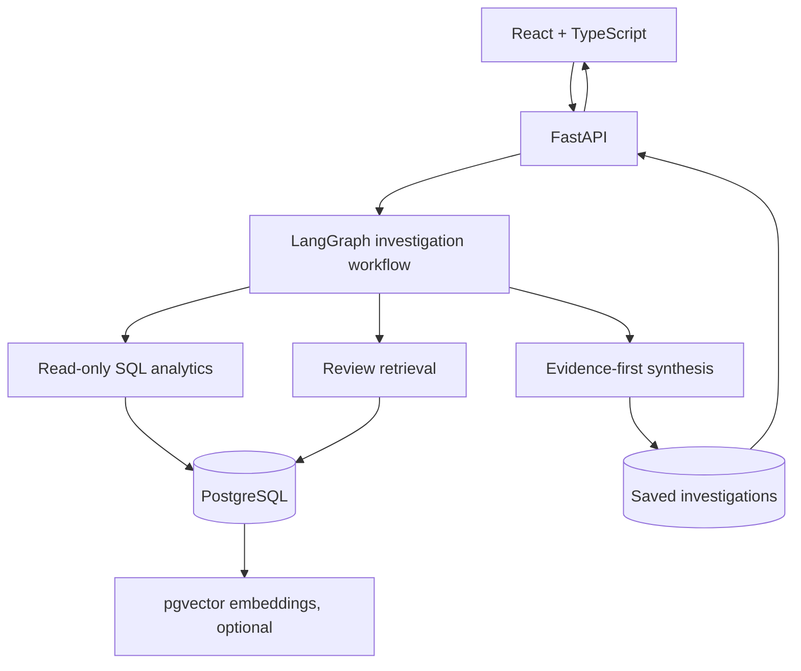

# BeautyPulse AI

**An evidence-first consumer intelligence and business analytics platform.** BeautyPulse combines SQL-backed commercial metrics, customer-review retrieval, a multi-step LangGraph investigation workflow, and a React analytics workspace. It is designed as a portfolio project for Analytics & AI Engineering roles.

> **Data transparency:** All product reviews, ratings, sales, returns, availability and campaign numbers seeded by this repository are synthetic. Product names in the demo are fictional. This project is not affiliated with, endorsed by, or connected to Honasa Consumer Limited, and it does not use Honasa private data.

## What is included

- **React + TypeScript dashboard:** portfolio overview, revenue trends, customer topics, a review explorer, investigation workspace and saved reports.
- **FastAPI backend:** typed endpoints, request validation, health checks and same-origin frontend serving in production.
- **PostgreSQL + pgvector:** structured business tables and optional 1,536-dimensional OpenAI text embeddings. SQLite is supported for a lightweight local demo.
- **SQL analytics:** comparison windows, sales/return metrics, average rating and topic count trends, with fixed parameterized queries validated through SQLGlot.
- **Review retrieval:** embedding similarity when a key is configured and review embeddings are available; otherwise an explicit lexical retrieval fallback.
- **LangGraph workflow:** plan → SQL metrics → review evidence → reconcile signals → generate report. Deterministic report logic works without a model API key.
- **Optional OpenAI integration:** constrained JSON executive-summary synthesis and review embeddings. Numeric metrics remain computed in SQL-backed application code.
- **MCP server:** read-only tools for product metrics, complaint trends and review evidence.
- **Evaluation scaffolding:** smoke tests and a small golden-question set to extend when you benchmark the app.
- **Docker + Render Blueprint:** build and deploy the UI/API as one service with a managed PostgreSQL database.

## Quick start (Docker — recommended)

Requirements: Docker Desktop / Docker Engine with Docker Compose.

1. Clone the repository or download and extract the ZIP.
2. In the project root, optionally copy `.env.example` to `.env` and add `OPENAI_API_KEY` if you want LLM synthesis and embedding-based search. Leaving it blank is supported.
3. Build and run:

   ```bash
   docker compose up --build
   ```

4. Open [http://localhost:8000](http://localhost:8000). The first startup creates tables and seeds the synthetic dataset.
5. API documentation is available at [http://localhost:8000/docs](http://localhost:8000/docs); health check at [http://localhost:8000/api/health](http://localhost:8000/api/health).

Stop the containers with `Ctrl+C`, then run `docker compose down`. Demo database files remain in the `beautypulse_pgdata` volume. To reset the synthetic database completely, run `docker compose down -v` and start again; **this deletes the local demo database**.

## Local development (without Docker)

Requirements: Python 3.12+, Node.js 20+.

### Backend

```bash
cd backend
python -m venv .venv
# macOS/Linux:
source .venv/bin/activate
# Windows PowerShell: .venv\Scripts\Activate.ps1
pip install -r requirements-dev.txt
cp ../.env.example .env  # optional; SQLite is the default
uvicorn app.main:app --reload --port 8000
```

### Frontend (second terminal)

```bash
cd frontend
npm install
npm run dev
```

Open [http://localhost:5173](http://localhost:5173). Vite proxies `/api` requests to the FastAPI server on port `8000`.

> If you created `.env` inside `backend/`, set `DATABASE_URL=sqlite:///./beautypulse.db` there. The app seeds its SQLite database the first time it starts. The exact current directory matters for SQLite's relative file path.

## Deploy to Render

This repository contains `render.yaml`, which defines one Docker web service and one PostgreSQL database.

1. Push the project to a GitHub repository.
2. In Render, choose **New → Blueprint**, connect that repository, and apply the `render.yaml` blueprint.
3. Wait for the database and web service to finish deploying. The backend's `/api/health` endpoint is configured as the health check.
4. Open the web service URL. The database will initialize and seed itself automatically.
5. Optional: in the Render web service's environment settings, add `OPENAI_API_KEY` to enable LLM synthesis and embeddings. Redeploy after setting it. Do not commit a real key to Git.

**Free-tier caveat:** Render's free web service may spin down after inactivity, and free Render PostgreSQL databases expire after 30 days. For a long-lived portfolio deployment, upgrade the database plan or change `DATABASE_URL` to a persistent PostgreSQL provider. Check current provider terms before deploying. The app can also be deployed using any Docker host and PostgreSQL instance. When a model key is configured, review embedding generation runs in the background so the API can finish starting promptly; lexical retrieval remains available while embeddings are being prepared.

### If a Render deployment fails

- Review the deploy logs for Docker build or Python dependency errors.
- Confirm `/api/health` reports a connected database.
- If you provide a custom `DATABASE_URL`, use a PostgreSQL connection URL. The application normalizes `postgres://` and `postgresql://` to the psycopg SQLAlchemy driver.
- PostgreSQL initialization enables `pgvector` with `CREATE EXTENSION IF NOT EXISTS vector`. The configured host must allow this extension.
- An OpenAI API key is **optional**. If embedding or LLM requests fail, the API logs the issue and keeps deterministic summaries / lexical retrieval available.

## Product walkthrough

1. Open **Overview** and change products or comparison windows.
2. Review the portfolio KPIs, sales trend and feedback topics.
3. Open **Consumer voice** and search phrases such as `packaging complaints`, `irritation concerns`, or `too expensive`.
4. Open **AI investigator**, choose a product and ask a question like:

   > Investigate the rating decline, compare revenue and return rate against the previous period, identify the top complaint theme, and recommend what to investigate next.

5. Expand **SQL transparency** to inspect the parameterized SELECT templates; inspect retrieved review IDs and limitations.
6. Open **Saved investigations** to revisit the stored report.

## Example API calls

```bash
curl http://localhost:8000/api/health
curl http://localhost:8000/api/products
curl 'http://localhost:8000/api/overview?product_id=1&days=30'
curl -X POST http://localhost:8000/api/investigate \
  -H 'Content-Type: application/json' \
  -d '{"question":"Investigate recent packaging complaints and business performance","product_id":1,"period_days":30}'
curl -X POST http://localhost:8000/api/reviews/search \
  -H 'Content-Type: application/json' \
  -d '{"query":"leaking bottle","product_id":1,"days":30,"limit":8}'
```

## MCP tools

The optional MCP server exposes read-only business-data tools. It uses the same `DATABASE_URL` and is intended to run as a separate local MCP process (it is not automatically launched with the web app).

```bash
# From the repository root; install backend/requirements.txt first.
python -m mcp_server.server
```

Available tools:

- `list_products`
- `get_product_metrics(product_id, days)`
- `get_complaint_trends(product_id, days)`
- `search_consumer_reviews(query, product_id, days, limit)`

In an MCP host, configure the command and environment to launch this module from the repository root, with the same `DATABASE_URL` as the application. The tool server communicates over stdio; do not send ordinary log messages to stdout in custom changes.

## Architecture



### Database tables

- `products`: fictional product catalogue
- `reviews`: synthetic review text, rating, review topic, sentiment, source and optional embedding
- `daily_metrics`: synthetic daily sales, returns, stock availability, advertising spend, impressions and conversions
- `investigations`: persisted report, metrics, citations, SQL templates, actions and limitations

### Safety and reliability choices

- The user question is **not** interpolated into SQL. The analysis workflow chooses fixed, parameterized query templates.
- SQL templates are parsed as a single read-only `SELECT` by SQLGlot before execution.
- The database tool layer uses fixed tables and bound parameters; deploy with a least-privilege database account for additional isolation.
- Reports explicitly distinguish observed co-movement from causation.
- AI suggestions are drafts for human review; the app does not execute purchasing, pricing, marketing or operational changes.
- Review text is untrusted evidence. Do not grant the workflow capabilities to execute instructions embedded in reviews.
- For a real deployment, add authentication/authorization, rate limits, automated migrations, structured audit logs, production secrets management and a formal privacy/security review.

## Evaluation

The `evaluation/golden_questions.jsonl` file is an initial benchmark seed. Expand it with representative answerable, ambiguous and unanswerable questions. Track SQL correctness, topic classification precision/recall, review Recall@5, citation support, end-to-end latency, tool errors, and whether the agent correctly reports missing data. Do not publish benchmark claims until measured against a labelled set.

Run tests with:

```bash
cd backend
pip install -r requirements-dev.txt
PYTHONPATH=. pytest ../tests -q
```

## Environment variables

| Variable | Required | Description |
|---|---|---|
| `DATABASE_URL` | In production | PostgreSQL URL; local default is SQLite |
| `ENABLE_DEMO_SEED` | No | Seed synthetic sample data if the products table is empty (default `true`) |
| `OPENAI_API_KEY` | No | Enables optional OpenAI synthesis and embeddings |
| `OPENAI_MODEL` | No | Chat model used for optional summary synthesis (default `gpt-4o-mini`) |
| `OPENAI_EMBEDDING_MODEL` | No | Embedding model (default `text-embedding-3-small`, 1,536 dimensions) |
| `ENABLE_REVIEW_EMBEDDINGS` | No | Enable embedding generation / retrieval if the key is set (default `true`) |
| `CORS_ORIGINS` | No | Comma-separated allowed web origins (default `*` for demo use) |

## License

MIT — see `LICENSE`.
